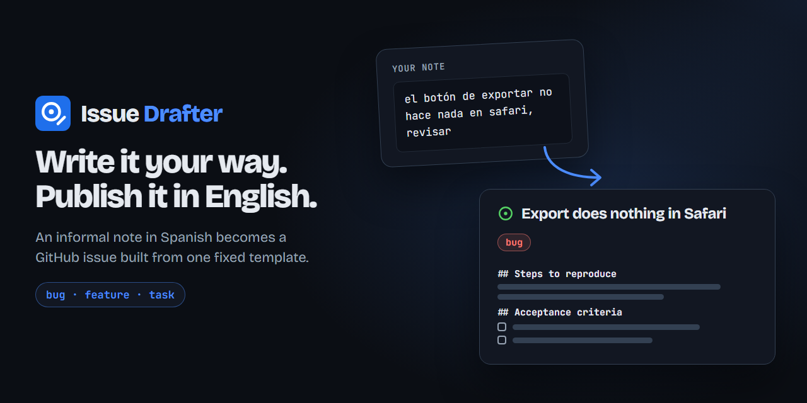
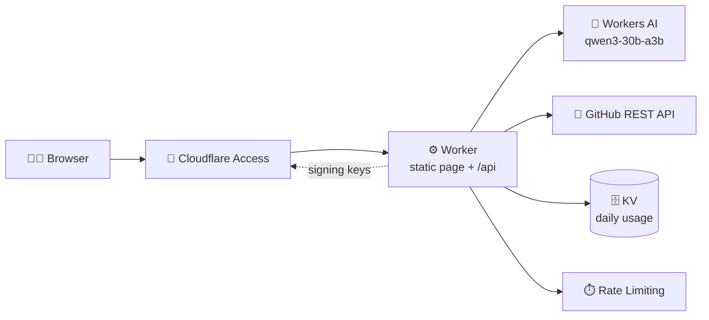

<p align="center">
  
</p>

<p align="center">
  <a href="https://github.com/Isma-L154/issue-drafter/actions/workflows/ci.yml"></a>
  <a href="https://github.com/Isma-L154/issue-drafter/actions/workflows/deploy.yml"></a>
  
  <a href="LICENSE"></a>
</p>

<p align="center">
  <b>Write an issue in your own words, in Spanish. Publish it in English, following one template.</b><br>
  A Cloudflare Worker behind Cloudflare Access drafts the issue with Workers AI and opens it through the GitHub API.
</p>

<p align="center">
  <a href="https://github.com/Isma-L154/issue-drafter/issues">Report a bug</a> ·
  <a href="#running-locally">Run it locally</a>
</p>

---

## What it does

- **Notes in your own words** — write as informally as you like; the model turns the note into issue fields.
- **One structure for every issue** — code, not the model, renders the fields into the template, so every issue has the same sections.
- **Three templates, chosen for you** — bug, feature or task, detected from the note or picked by hand, each with its own label.
- **No invented details** — anything the note does not say becomes an open question, and empty optional sections are left out.
- **Links kept honest** — URLs in the note become Markdown links with a short descriptive text; a draft that adds, alters or drops a URL is rejected and regenerated.
- **Review before publishing** — preview the issue, ask for a correction in plain words, then publish.
- **Several repositories at once** — publish the same issue to up to ten repositories.

| Type | Sections | Label |
|---|---|---|
| Bug | Summary, Steps to reproduce, Expected, Actual, Impact, Acceptance criteria, Open questions | `bug` |
| Feature | Goal, Context, Proposed behavior, Acceptance criteria, Out of scope, Open questions | `enhancement` |
| Task | Goal, Context, Scope, Acceptance criteria, Out of scope, Open questions | `task` |

## How it works



The page in `public/` is static; only `/api/*` runs the Worker (`src/`). Every
API call verifies the Access JWT against the team's signing keys before doing
anything, so a misconfigured Access application fails closed. The model only
returns fields; `src/render.ts` turns them into the issue body, which keeps the
structure out of the model's hands.

Daily caps live in KV as one counter per day; the per-minute limits use the
Rate Limiting bindings, keyed by the Access identity.

**Stack:** Cloudflare Workers (static assets, KV, Rate Limiting) · Workers AI (`@cf/qwen/qwen3-30b-a3b-fp8`) · Cloudflare Access · GitHub REST API · TypeScript · Vitest in `workerd`

Everything runs on free tiers.

## Running locally

Needs **Node 22**, the version CI uses.

```sh
npm install
cp .dev.vars.example .dev.vars   # then add a GitHub token
npm run dev                      # wrangler dev
npm run typecheck                # wrangler types + tsc
npm test                         # Vitest in workerd
npm run eval                     # sample notes against the real model; needs CLOUDFLARE_API_TOKEN
```

Under `npm run dev` the page loads but every API call except `/api/health`
answers 403: it requires a Cloudflare Access JWT, which only Access adds. The
API is exercised by the tests, with Access, GitHub and the model faked.

| Variable | Description |
|---|---|
| `GITHUB_TOKEN` | Worker secret. Fine-grained token with Issues read and write; locally in `.dev.vars`. |
| `GITHUB_OWNER` | Worker var. The account that owns the repositories issues are opened in. |
| `SITE_ORIGIN` | Worker var. The only `Origin` accepted on POST requests. |
| `ACCESS_TEAM_DOMAIN`, `ACCESS_AUD` | Worker vars. The Access application the JWT must belong to. |
| `MODEL` | Worker var. The Workers AI model that drafts the fields. |
| `DAILY_DRAFT_CAP`, `DAILY_PUBLISH_CAP` | Worker vars. Daily limits. |

Worker vars are set in `wrangler.jsonc`. `.dev.vars` is git-ignored and never
committed.

The banner is drawn in HTML. To regenerate it:

```sh
node docs/brand/build-banner.mjs
npx -y playwright@1.63.0 screenshot --viewport-size "1280,640" "file:///<absolute path>/docs/brand/banner.html" docs/brand/banner.png
```

## Deployment

Pushes to `main` deploy automatically once CI passes: the deploy workflow runs
the checks again, runs `wrangler deploy`, then verifies that `/api/health`
answers with HSTS and that every other path redirects to the Access login.

It needs one repository secret, `CLOUDFLARE_API_TOKEN`. `GITHUB_TOKEN` is set
once with `wrangler secret put GITHUB_TOKEN`.

## Security

- Cloudflare Access guards the site, and the Worker verifies the Access JWT on
  every API call, so a misconfigured Access application fails closed.
- The GitHub token can only read and write issues.
- Per-minute rate limits on every GitHub or model call, checked before the call,
  and daily caps on drafts (150) and published issues (50).
- Same-origin JSON requests only, bodies capped at 64 KB while they stream.
- Strict Content Security Policy and HSTS.
- Missing configuration answers 500 everywhere, health included, so a broken
  deploy fails its verification.
- Note and draft contents are never logged.

[SECURITY.md](SECURITY.md) decides the seven baseline controls.

## License

[MIT](LICENSE). The banner uses Bricolage Grotesque and JetBrains Mono under the
SIL Open Font License 1.1 ([licenses](docs/brand/fonts/)).
